# Computer Graphics Experiments

**Name:** MOHAN CHANDRA S S  
**USN:** 1RVU23CSE282  

This repository contains ten computer graphics experiments implemented in Python using OpenGL. Each experiment demonstrates a fundamental graphics algorithm and produces a visual result.

---

## Experiment 1: DDA and Bresenham Line Drawing Algorithms

**File:** `experiments/Experiment_1/exp1.py`

### Overview
This experiment implements two classic line drawing algorithms:
- **DDA (Digital Differential Analgorithm)** - A simple line drawing algorithm that uses floating-point arithmetic
- **Bresenham's Line Algorithm** - An efficient line drawing algorithm using integer arithmetic

### Formulas and Operations

#### DDA Algorithm
- **Step calculation:** `steps = max(abs(dx), abs(dy))` where `dx = x2 - x1` and `dy = y2 - y1`
- **Increment values:** 
  - `x_inc = dx / steps`
  - `y_inc = dy / steps`
- **Line generation:** Iterates from 0 to `steps`, plotting points at each step by incrementing x and y by their respective increments
- **Pixel plotting:** `plot(x, y)` rounds coordinates to nearest integer: `int(round(x)), int(round(y))`

#### Bresenham Algorithm
- **Error term initialization:** `err = dx - dy` where `dx = abs(x2 - x1)` and `dy = abs(y2 - y1)`
- **Decision parameters:**
  - If `e2 > -dy`: adjust error by `-dy` and increment x by `sx`
  - If `e2 < dx`: adjust error by `dx` and increment y by `sy`
- **Step direction:** `sx = 1 if x1 < x2 else -1`, `sy = 1 if y1 < y2 else -1`
- **Plot points** at `(x1, y1)` iteratively until reaching `(x2, y2)`

### Visual Result
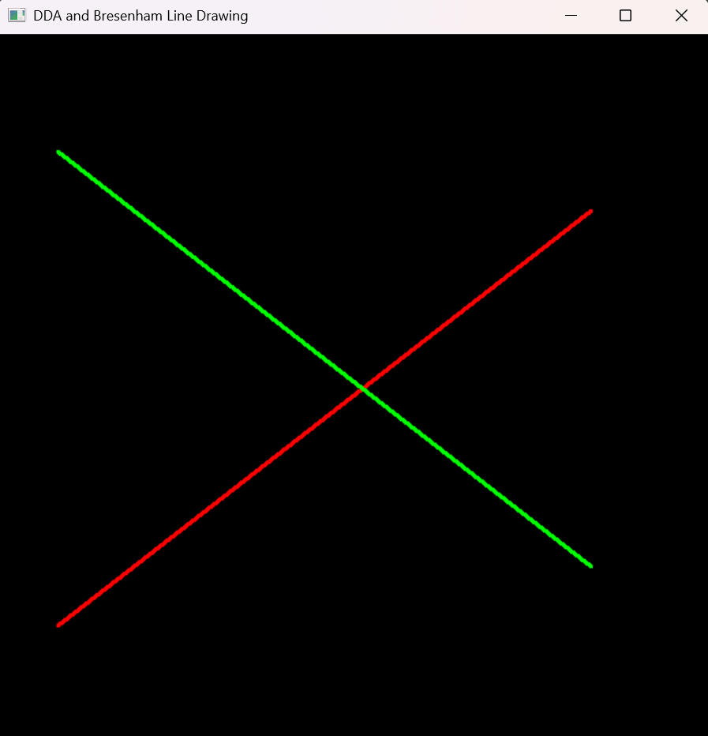

*The image shows a red line drawn using DDA algorithm and a green line drawn using Bresenham algorithm between the points (50, 100) to (500, 450) and (50, 500) to (500, 150) respectively.*

---

## Experiment 2: Midpoint Circle Drawing Algorithm

**File:** `experiments/Experiment_2/exp2.py`

### Overview
This experiment implements the **Midpoint Circle Algorithm**, an efficient method for drawing circles using only integer arithmetic and symmetry.

### Formulas and Operations

#### Midpoint Circle Algorithm
- **Initial decision parameter:** `p = 1 - r` where `r` is the circle radius
- **Starting point:** `(x, y) = (0, r)` at the top of the circle
- **Iteration loop** continues while `x < y`:
  - **Increment x:** `x += 1`
  - **Decision logic:**
    - If `p < 0`: `p += 2 * x + 1` (move east only)
    - If `p >= 0`: `y -= 1` and `p += 2 * (x - y) + 1` (move southeast)
- **Symmetry plotting:** For each calculated point `(x, y)`, all 8 symmetric points are plotted:
  - `(xc ± x, yc ± y)` and `(xc ± y, yc ± x)`

#### Key Insight
The algorithm exploits the 8-way symmetry of circles, so only one octant needs to be calculated, and the rest are derived by symmetry.

### Visual Result
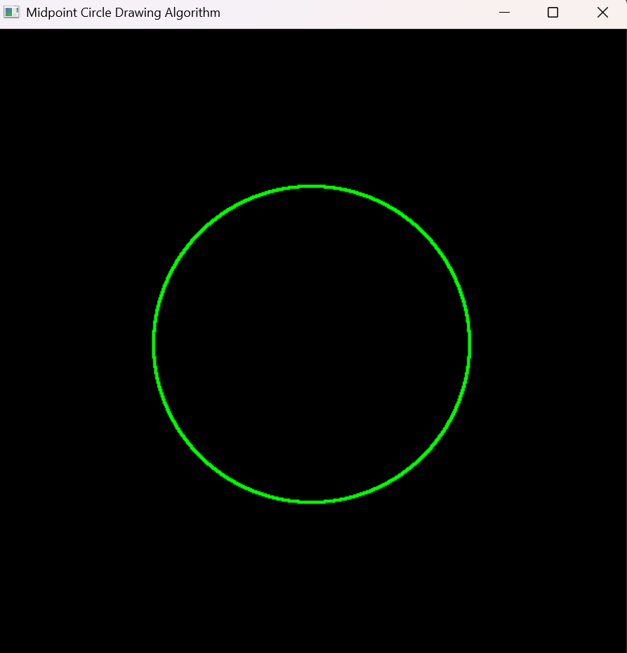

*The image shows a green circle centered at (300, 300) with radius 150, drawn using the midpoint circle algorithm.*

---

## Experiment 3: 2D Transformations Using Homogeneous Coordinates

**File:** `experiments/Experiment_3/exp3.py`

### Overview
This experiment demonstrates **2D geometric transformations** using homogeneous coordinates. It applies multiple transformation matrices to a triangle and displays the original and transformed results.

### Formulas and Operations

#### Homogeneous Coordinates
- Points represented as `[x, y, 1]` for transformation compatibility
- All transformations use 3×3 matrices operating on homogeneous coordinate vectors

#### Transformation Matrices

**1. Translation**
```
T(tx, ty) = [[1, 0, tx],
             [0, 1, ty],
             [0, 0, 1]]
```
- Moves point by `tx` in x-direction and `ty` in y-direction

**2. Rotation**
```
R(angle) = [[cos(θ), -sin(θ), 0],
            [sin(θ),  cos(θ), 0],
            [0,       0,      1]]
```
- Rotates point by `angle` degrees counterclockwise
- Uses `θ = math.radians(angle)` to convert to radians

**3. Scaling**
```
S(sx, sy) = [[sx, 0, 0],
             [0,  sy, 0],
             [0,  0,  1]]
```
- Scales by `sx` in x-direction and `sy` in y-direction

**4. Reflection**
```
Reflection X: [[1, 0, 0],   [0, -1, 0],   [0, 0, 1]]
Reflection Y: [[-1, 0, 0],   [0,  1, 0],   [0, 0, 1]]
```

**5. Shearing**
```
Sh(shx, shy) = [[1, shx, 0],
                [shy, 1,  0],
                [0,   0,  1]]
```

#### Triangle Transformation Pipeline
- Original triangle vertices: `(0, 0)`, `(100, 0)`, `(50, 100)`
- Each transformation is applied via `transform_triangle(matrix)` which multiplies the matrix by each point
- Original triangle displayed in gray, transformed triangles in various colors

### Visual Result
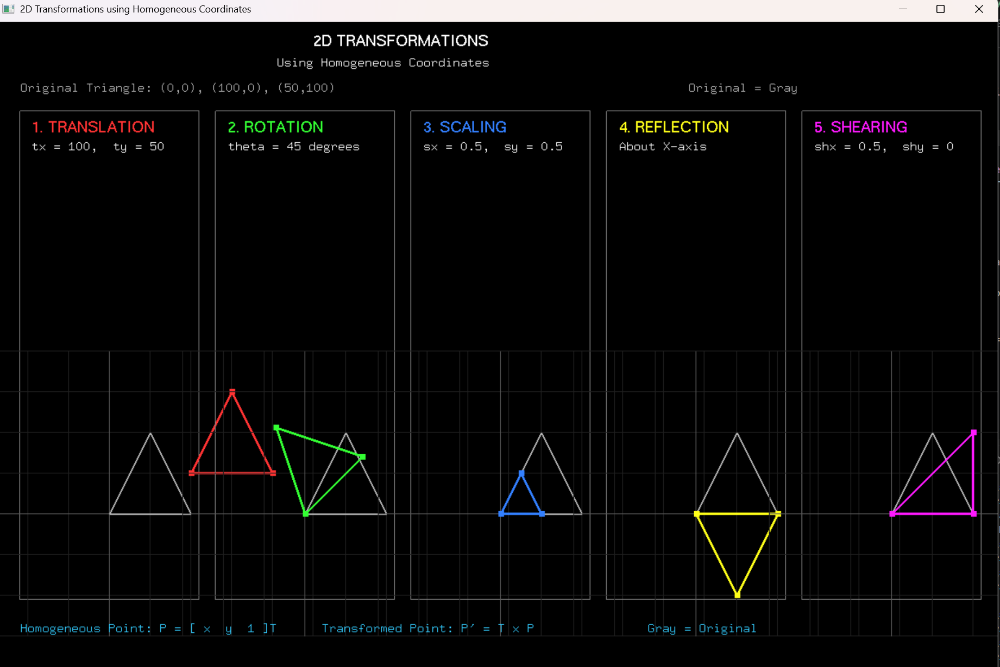

*The image displays the original triangle (gray) and its transformed versions under translation, rotation (45°), scaling (0.5x), reflection about X-axis, and shearing (0.5), each shown in separate panels with their respective parameter labels.*

---

## Experiment 4: Composite 2D Transformations Using Matrix Representation

**File:** `experiments/Experiment_4/exp4.py`

### Overview
This experiment demonstrates **composite 2D geometric transformations** using matrix representation with homogeneous coordinates. It applies a sequence of scaling, rotation, and translation transformations to a 2D triangle and displays the individual and composite matrices alongside the visual output.

### Formulas and Operations

#### Homogeneous Coordinates & 3x3 Matrices
- **Scaling Matrix S:** `sx = 1.5, sy = 1.5`
- **Rotation Matrix R:** `θ = 45°` (`math.radians(45)`)
- **Translation Matrix T:** `tx = 250, ty = 120`

#### Composite Matrix Formula
- **Pipeline:** `Original -> Scaling -> Rotation -> Translation -> Final`
- **Composite Matrix:** `M = T x R x S`
- **Transformed Point:** `P' = M x P`
- **Non-Commutativity:** Note that matrix multiplication is non-commutative (`T x R x S != S x R x T`), so the transformations are evaluated right-to-left.

### Visual Result
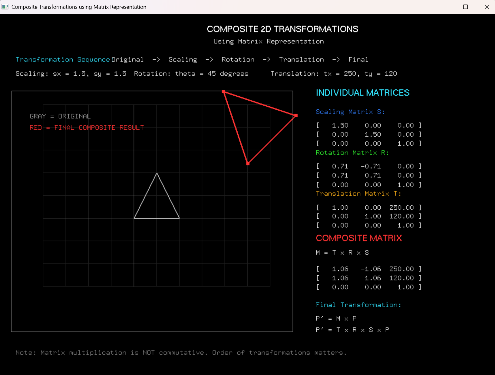

*The image displays the original triangle (gray), the composite transformed result (red), and the individual transformation matrices alongside the computed 3x3 composite matrix.*

---

## Experiment 5: Cohen-Sutherland Line Clipping Algorithm

**File:** `experiments/Experiment_5/exp5.py`

### Overview
This experiment implements the **Cohen-Sutherland Line Clipping Algorithm**, an efficient 2D line clipping technique that uses 4-bit region codes (outcodes) to clip line segments against a rectangular viewing window.

### Formulas and Operations

#### Region Codes (Outcodes)
The 2D space is divided into 9 regions defined by 4-bit region codes `[TOP, BOTTOM, RIGHT, LEFT]`:
- **TOP** (`1000` = 8): `y > Y_MAX`
- **BOTTOM** (`0100` = 4): `y < Y_MIN`
- **RIGHT** (`0010` = 2): `x > X_MAX`
- **LEFT** (`0001` = 1): `x < X_MIN`
- **INSIDE** (`0000` = 0)

#### Decision & Clipping Logic
- **Trivial Accept:** `code1 == 0` and `code2 == 0`
- **Trivial Reject:** `(code1 & code2) != 0`
- **Intersection Formulas:**
  - **Top (`y = Y_MAX`):** `x = x1 + (x2 - x1) * (Y_MAX - y1) / (y2 - y1)`
  - **Bottom (`y = Y_MIN`):** `x = x1 + (x2 - x1) * (Y_MIN - y1) / (y2 - y1)`
  - **Right (`x = X_MAX`):** `y = y1 + (y2 - y1) * (X_MAX - x1) / (x2 - x1)`
  - **Left (`x = X_MIN`):** `y = y1 + (y2 - y1) * (X_MIN - x1) / (x2 - x1)`

#### Window Coordinates
- `X_MIN = 100`, `X_MAX = 500`, `Y_MIN = 100`, `Y_MAX = 400`

### Visual Result
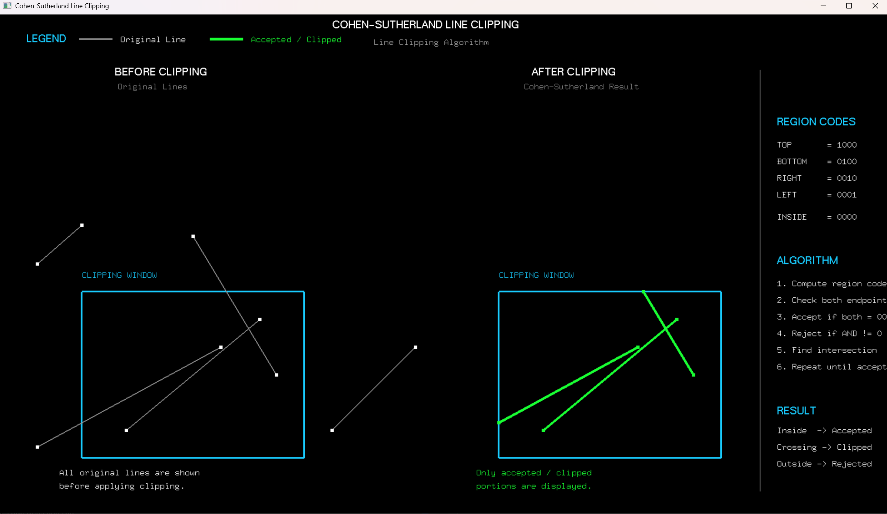

*The image shows a side-by-side comparison: the left panel displays the original test lines inside/outside the blue clipping window, the middle panel shows only the accepted and clipped line segments in green, and the right panel details the 4-bit region codes and step-by-step clipping algorithm logic.*

---

## Experiment 6: Z-Buffer Algorithm for Hidden Surface Removal

**File:** `experiments/Experiment_6/exp6.py`

### Overview
This experiment implements the **Z-buffer (Depth-Buffer) Algorithm**, a foundational image-space approach for hidden surface removal in 3D computer graphics. By maintaining a 2D depth buffer alongside the color framebuffer, the algorithm ensures that surfaces closest to the viewer are correctly drawn, while occluded surfaces are discarded, regardless of polygon submission order.

### Formulas and Operations

#### Depth Calculation & Linear Recurrence
For a polygon planar surface $Ax + By + Cz + D = 0$, depth $z$ at pixel $(x, y)$ is given by:
$$z = \frac{-Ax - By - D}{C}$$

When stepping along a scanline ($\Delta x = 1$):
$$z' = z - \frac{A}{C}$$

#### Z-Buffer Decision Logic
For each projected fragment at $(x, y)$ with depth $z$:
- **Condition:** $\text{If } z < Z_{\text{buffer}}(x, y)$
  - $Z_{\text{buffer}}(x, y) \leftarrow z$
  - $\text{ColorBuffer}(x, y) \leftarrow \text{PolygonColor}$
- Otherwise, the fragment is discarded as occluded.

#### Comparative Demonstration
- **Left Viewport (Depth Test Disabled):** Demonstrates the Painter's algorithm failure where later-drawn green ($Z = -0.2$) and blue ($Z = -0.6$) triangles incorrectly overwrite the closer red triangle ($Z = 0.5$).
- **Right Viewport (Depth Test Enabled):** Hardware Z-buffering with `GL_LESS` resolves visibility per-pixel, correctly keeping the closer red triangle in front.

### Visual Result
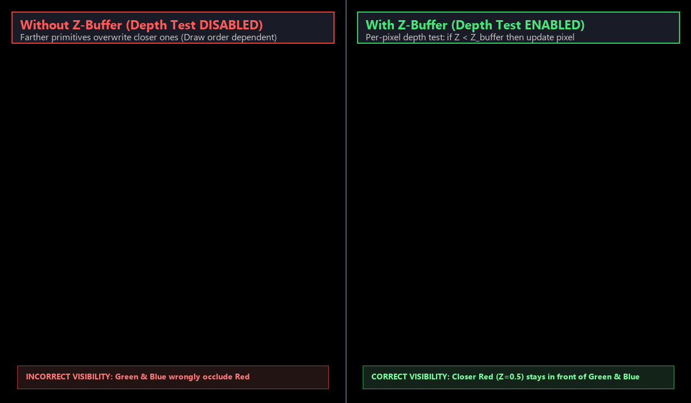

*The image displays a side-by-side comparison: the left viewport shows incorrect visibility when depth testing is disabled (later-drawn green and blue triangles incorrectly overwrite the red triangle), while the right viewport demonstrates correct hidden surface removal using the Z-buffer algorithm, preserving the closer red triangle in front.*

---

## Experiment 7: Phong Illumination Model for a 3D Object

**File:** `experiments/Experiment_7/exp7.py`

### Overview
This experiment implements the **Phong Illumination Model**, a standard local shading formulation that evaluates the total reflected light intensity on 3D surfaces as the sum of ambient, diffuse (Lambertian), and specular components.

### Formulas and Operations

#### Total Illumination Formula
$$I = I_{\text{ambient}} + I_{\text{diffuse}} + I_{\text{specular}}$$
$$I = k_a I_a + k_d (\vec{N} \cdot \vec{L}) I_d + k_s (\vec{R} \cdot \vec{V})^\alpha I_s$$

#### Vectors and Terms
- **Surface Normal ($\vec{N}$):** Unit normal vector at the surface point (for a unit sphere, $\vec{N} = (x, y, z)$).
- **Light Vector ($\vec{L}$):** Unit vector directed from the surface point towards the light source.
- **Viewer Vector ($\vec{V}$):** Unit vector directed towards the camera $(0, 0, 1)$.
- **Reflection Vector ($\vec{R}$):** Direction of perfect specular reflection:
  $$\vec{R} = 2(\vec{N} \cdot \vec{L})\vec{N} - \vec{L}$$
- **Shininess Exponent ($\alpha$):** Exponent controlling the sharpness and spread of the specular highlight ($\alpha = 32$).

#### Decomposition
The program splits the illumination model into four distinct panels:
1. **Ambient Component ($I_{\text{ambient}}$):** Uniform baseline environment illumination ($k_a I_a$).
2. **Diffuse Component ($I_{\text{diffuse}}$):** Lambertian scattering proportional to $\max(0, \vec{N} \cdot \vec{L})$.
3. **Specular Component ($I_{\text{specular}}$):** Mirror highlight proportional to $\max(0, \vec{R} \cdot \vec{V})^\alpha$.
4. **Full Phong Model ($I$):** Complete combined illumination producing realistic 3D appearance.

### Visual Result
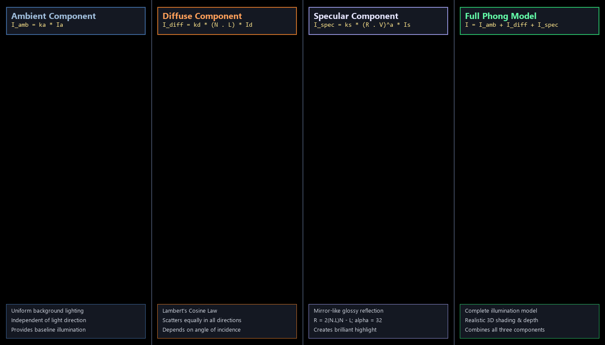

*The image displays a comprehensive four-panel decomposition of the Phong illumination model applied to a 3D sphere: Panel 1 shows the uniform Ambient component ($I_{amb}$), Panel 2 displays the Lambertian Diffuse shading ($I_{diff}$), Panel 3 isolates the glossy Specular highlight ($I_{spec}$), and Panel 4 combines all three into the complete photorealistic Phong illumination model.*

---

## Experiment 8: OpenGL Vertex and Fragment Shaders

**File:** `experiments/Experiment_8/exp8.py`

### Overview
This experiment demonstrates the **modern programmable graphics pipeline** in OpenGL using GLSL (OpenGL Shading Language) version 3.3 Core Profile. It showcases GPU buffer management with VAO/VBOs, vertex position transformation via a vertex shader, and per-vertex color interpolation modulated by a fragment shader.

### Formulas and Operations

#### Pipeline Architecture
```
[Vertex Attributes (Position, Color)] -> [VAO/VBO] -> [Vertex Shader] -> [Rasterizer] -> [Fragment Shader] -> [Framebuffer]
```

#### 1. Vertex Shader (GLSL 330 Core)
Transforms vertex positions using a 2D rotation matrix driven by the uniform variable `angle` ($\theta$):
$$\begin{bmatrix} x' \\ y' \end{bmatrix} = \begin{bmatrix} \cos\theta & -\sin\theta \\ \sin\theta & \cos\theta \end{bmatrix} \begin{bmatrix} x \\ y \end{bmatrix}$$
$$\text{gl\_Position} = \begin{bmatrix} x' \\ y' \\ z \\ 1.0 \end{bmatrix}, \quad \text{vertexColor} = \text{aColor}$$

#### 2. Fragment Shader (GLSL 330 Core)
Interpolates vertex colors smoothly across the triangle using barycentric coordinates and applies a continuous sine-wave time pulsation:
$$\text{pulse}(t) = 0.5 + 0.5 \sin(2.5 \cdot t)$$
$$\text{FragColor} = \text{vec4}(\text{vertexColor} \times (0.75 + 0.25 \cdot \text{pulse}(t)), 1.0)$$

#### 3. Buffer Objects
- **VBO (Vertex Buffer Object):** Interleaved array containing 3D vertex positions and RGB colors.
- **VAO (Vertex Array Object):** Configures and enables vertex attribute pointers 0 (Position) and 1 (Color).

### Visual Result
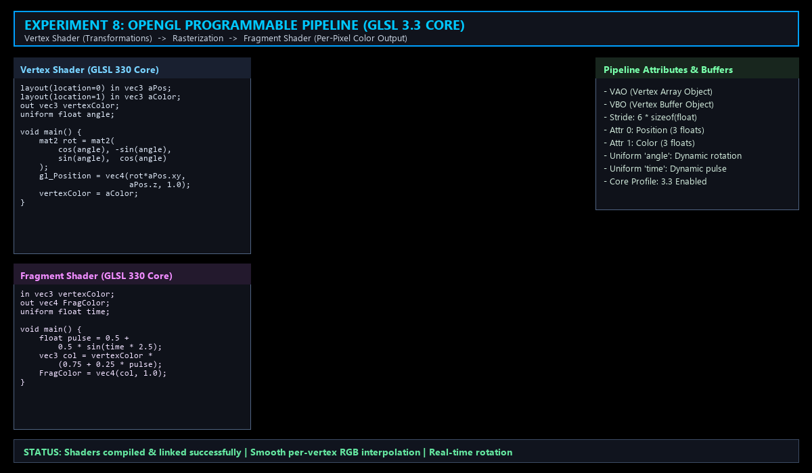

*The image shows the modern OpenGL 3.3 programmable pipeline in action: an animated, smoothly color-interpolated RGB triangle rendered using custom GLSL vertex and fragment shaders with per-vertex color attributes, GPU buffer management (VAO/VBO), and dynamic rotation uniforms.*

---

## Experiment 9: Simple Interactive 3D Scene

**File:** `experiments/Experiment_9/exp9.py`

### Overview
This experiment demonstrates the construction of a **simple interactive 3D scene**, incorporating game engine concepts (as seen in Unity) directly in Python using OpenGL. The scene features a 3D arena floor grid, a controllable player character, third-person camera tracking, 3D obstacle blocks, rotating animated collectible gems, collision detection, and a real-time Heads-Up Display (HUD).

### Formulas and Operations

#### 1. Player Kinematics & Jump Physics
- **Horizontal Displacement:**
  $$\Delta x = -v \cdot \Delta t \cdot \sin(\theta), \quad \Delta z = v \cdot \Delta t \cdot \cos(\theta)$$
- **Euler Gravity & Jump Simulation:**
  $$v_y(t + \Delta t) = v_y(t) - g \cdot \Delta t, \quad y(t + \Delta t) = y(t) + v_y(t) \cdot \Delta t$$
  $$\text{Jump Impulse: } v_y = 8.5 \text{ m/s when grounded}$$

#### 2. Third-Person Following Camera Pipeline
Calculates dynamic camera position $\vec{C}$ following player position $\vec{P}$ at orientation angle $\theta$:
$$C_x = P_x - d_{\text{cam}} \cdot \sin(\theta), \quad C_z = P_z + d_{\text{cam}} \cdot \cos(\theta), \quad C_y = P_y + h_{\text{cam}}$$
View matrix is set via `gluLookAt(cam_x, cam_y, cam_z, player_x, player_y + 0.6, player_z, 0, 1, 0)`.

#### 3. Continuous Gem Rotation & Proximity Collision
- **Rotation:** $\phi(t) = \omega \cdot t$ ($\omega = 75^\circ/\text{s}$)
- **Harmonic Oscillation:** $y_{\text{gem}}(t) = y_0 + A \sin(\omega_{\text{bob}} t)$
- **Pickup Radius:** Gathered when Euclidean distance $\sqrt{(P_x - C_x)^2 + (P_z - C_z)^2} < 1.3\text{m}$.

### Visual Result
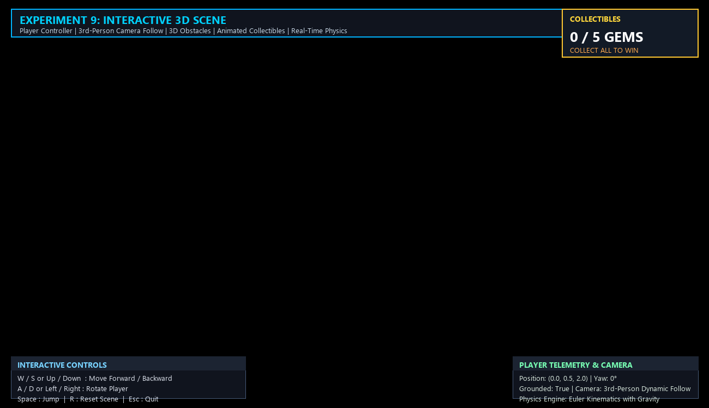

*The image shows the interactive 3D scene in real time: a third-person view of the player avatar navigating a checkered arena floor, surrounded by 3D obstacles and rotating collectible diamond gems, accompanied by an integrated Heads-Up Display (HUD) showing collectibles gathered, player telemetry, and interactive control bindings.*

---

## Experiment 10: 3D Viewing Pipeline, Projection and Viewport Mapping

**File:** `experiments/Experiment_10/exp10.py`

### Overview
This experiment implements the complete **3D Viewing Pipeline**, demonstrating how 3D geometric models are converted into a 2D screen image through sequential coordinate transformations. It highlights the difference between **Orthographic Projection** (engineering / CAD perspective) and **Perspective Projection** (natural human vision) using side-by-side viewports displaying an animated multi-colored 3D cube.

### Formulas and Operations

#### Viewing Pipeline Transformation Sequence
```
[Object Coordinates] -> [World Coordinates] -> [Eye / View Coordinates] -> [Clip Coordinates] -> [NDC] -> [Screen Viewports]
```

#### 1. View Matrix Transformation (`gluLookAt`)
Transforms world coordinates to camera coordinates with eye at $(4, 3, 6)$ and target at $(0, 0, 0)$:
$$M_{\text{view}} = \begin{bmatrix} \vec{x}_c & -\vec{x}_c \cdot \vec{E} \\ \vec{y}_c & -\vec{y}_c \cdot \vec{E} \\ \vec{z}_c & -\vec{z}_c \cdot \vec{E} \\ \mathbf{0} & 1 \end{bmatrix}$$

#### 2. Projection Matrices ($M_{\text{proj}}$)
- **Orthographic Projection (`glOrtho`):** Parallel projectors maintain object proportions and parallel lines:
  $$M_{\text{ortho}} = \begin{bmatrix} \frac{2}{r-l} & 0 & 0 & -\frac{r+l}{r-l} \\ 0 & \frac{2}{t-b} & 0 & -\frac{t+b}{t-b} \\ 0 & 0 & -\frac{2}{f-n} & -\frac{f+n}{f-n} \\ 0 & 0 & 0 & 1 \end{bmatrix}$$
- **Perspective Projection (`gluPerspective`):** Projectors converge at center of projection, yielding depth foreshortening:
  $$M_{\text{persp}} = \begin{bmatrix} \frac{\cot(\text{fovy}/2)}{\text{aspect}} & 0 & 0 & 0 \\ 0 & \cot(\text{fovy}/2) & 0 & 0 \\ 0 & 0 & -\frac{f+n}{f-n} & -\frac{2fn}{f-n} \\ 0 & 0 & -1 & 0 \end{bmatrix}$$

#### 3. Viewport Mapping
Transforms Normalized Device Coordinates (NDC) in $[-1, 1]^2$ to physical pixel coordinates:
$$x_s = x_v + \frac{x_{\text{ndc}} + 1}{2} \cdot w_v, \quad y_s = y_v + \frac{y_{\text{ndc}} + 1}{2} \cdot h_v$$

### Visual Result
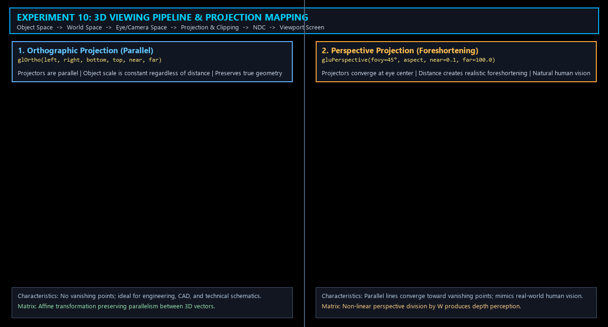

*The image demonstrates the complete 3D viewing pipeline in a side-by-side comparison: the left viewport displays an orthographic projection where parallel cube edges remain strictly parallel without foreshortening (ideal for engineering/CAD), while the right viewport displays a perspective projection with natural foreshortening and vanishing points (modeling real-world human vision).*

---

## How to Run

Each experiment can be run independently using Python with OpenGL support:

```bash
# Experiment 1: DDA and Bresenham Line Drawing
python experiments/Experiment_1/exp1.py

# Experiment 2: Midpoint Circle Drawing
python experiments/Experiment_2/exp2.py

# Experiment 3: 2D Transformations
python experiments/Experiment_3/exp3.py

# Experiment 4: Composite 2D Transformations
python experiments/Experiment_4/exp4.py

# Experiment 5: Cohen-Sutherland Line Clipping
python experiments/Experiment_5/exp5.py

# Experiment 6: Z-Buffer Hidden Surface Removal
python experiments/Experiment_6/exp6.py

# Experiment 7: Phong Illumination Model
python experiments/Experiment_7/exp7.py

# Experiment 8: Vertex and Fragment Shaders
python experiments/Experiment_8/exp8.py

# Experiment 9: Simple Interactive 3D Scene
python experiments/Experiment_9/exp9.py

# Experiment 10: 3D Viewing Pipeline
python experiments/Experiment_10/exp10.py
```

### Headless Screenshot Capture
Experiments 6 through 10 support the `--headless` flag to generate and save output screenshots without opening a persistent display window:
```bash
python experiments/Experiment_6/exp6.py --headless
python experiments/Experiment_7/exp7.py --headless
python experiments/Experiment_8/exp8.py --headless
python experiments/Experiment_9/exp9.py --headless
python experiments/Experiment_10/exp10.py --headless
```

**Requirements:**
- Python 3.x
- PyOpenGL
- PyGLUT
- GLFW (`pip install glfw`)
- NumPy (`pip install numpy`)
- Pillow (`pip install pillow`)

## License

These experiments are for educational purposes, demonstrating fundamental computer graphics algorithms.

---

## Projects

This folder contains various computer graphics and Python projects completed during the semester.

---

### Spider-Man Animation

**File:** `projects/spider-man.py`

### Overview
A Python script using OpenGL to render a Spider-Man character animation. The project demonstrates character rendering, animation loops, and interactive graphics using OpenGL.

### Features
- Spider-Man character design using OpenGL primitives
- Animation loop for continuous rendering
- 2D graphics rendering pipeline
- Keyboard/mouse interaction support

### Visual Result
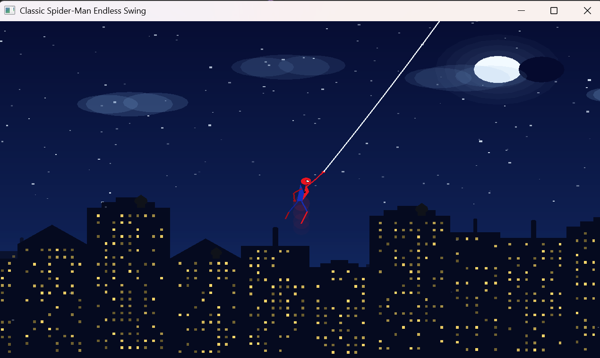

*The image shows the Spider-Man character rendered with OpenGL, demonstrating character animation and rendering techniques.*

### How to Run

```bash
python projects/spider-man.py
```

**Requirements:**
- Python 3.x
- PyOpenGL
- PyGLUT

---
