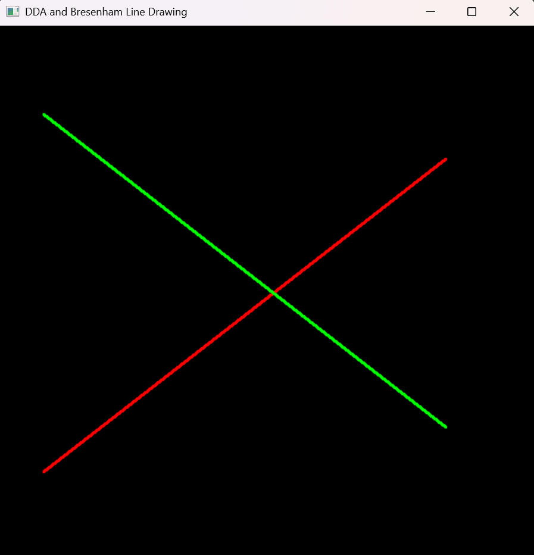

# Experiment 1: DDA and Bresenham Line Drawing Algorithms

**File:** `exp1.py`

## Overview
This experiment implements two classic line drawing algorithms in OpenGL:
- **DDA (Digital Differential Analyzer)** - A simple line drawing algorithm that uses floating-point arithmetic.
- **Bresenham's Line Algorithm** - An efficient line drawing algorithm using integer arithmetic.

## Formulas and Operations

### DDA Algorithm
- **Step calculation:** `steps = max(abs(dx), abs(dy))` where `dx = x2 - x1` and `dy = y2 - y1`
- **Increment values:** 
  - `x_inc = dx / steps`
  - `y_inc = dy / steps`
- **Line generation:** Iterates from 0 to `steps`, plotting points at each step by incrementing x and y by their respective increments
- **Pixel plotting:** `plot(x, y)` rounds coordinates to nearest integer: `int(round(x)), int(round(y))`

### Bresenham Algorithm
- **Error term initialization:** `err = dx - dy` where `dx = abs(x2 - x1)` and `dy = abs(y2 - y1)`
- **Decision parameters:**
  - If `e2 > -dy`: adjust error by `-dy` and increment x by `sx`
  - If `e2 < dx`: adjust error by `dx` and increment y by `sy`
- **Step direction:** `sx = 1 if x1 < x2 else -1`, `sy = 1 if y1 < y2 else -1`
- **Plot points** at `(x1, y1)` iteratively until reaching `(x2, y2)`

## Visual Result


*The image shows a red line drawn using DDA algorithm and a green line drawn using Bresenham algorithm between the points (50, 100) to (500, 450) and (50, 500) to (500, 150) respectively.*

## How to Run

```bash
python exp1.py
```

### Requirements
- Python 3.x
- PyOpenGL
- PyGLUT
