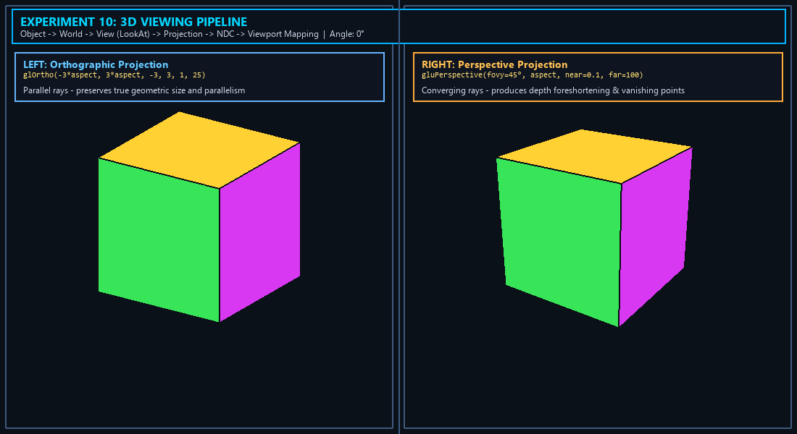
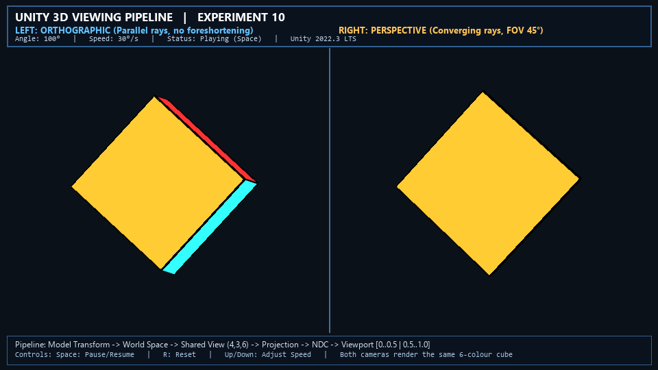

# Experiment 10: 3D Viewing Pipeline, Projection and Viewport Mapping

**File:** `exp10.py`  
**Unity Project:** `unity_project/`

## Overview
This experiment implements the complete **3D Viewing Pipeline** in computer graphics, transforming geometric primitives from 3D object space to a 2D digital screen. The program demonstrates the contrast between **Orthographic Projection** (parallel rays preserving geometric proportions) and **Perspective Projection** (converging rays modeling realistic human depth perception) using side-by-side viewports displaying an animated 3D multi-colored cube with depth buffering.

## Formulas and Operations

### The 3D Viewing Pipeline Stages
The 3D viewing transformation pipeline progresses through six coordinate spaces:
```
[Object Coordinates] 
       │  Model Matrix (M_model)
       ▼
[World Coordinates] 
       │  View Matrix (M_view)
       ▼
[Eye / Camera Coordinates] 
       │  Projection Matrix (M_proj)
       ▼
[Clip Coordinates] 
       │  Perspective Division (/w)
       ▼
[Normalized Device Coordinates (NDC)] 
       │  Viewport Matrix (M_viewport)
       ▼
[Screen / Window Coordinates]
```

### 1. Modeling Transformation ($M_{\text{model}}$)
Positions, scales, and rotates the 3D cube from local object coordinates $(x_o, y_o, z_o)$ into world space $(x_w, y_w, z_w)$ using Euler rotation angles around the diagonal axis $(1, 1, 0)$:
$$P_w = M_{\text{model}} \cdot P_o$$

### 2. View Transformation ($M_{\text{view}}$)
Transforms world coordinates into eye/camera coordinates where the camera sits at origin $(0, 0, 0)$ looking down the $-Z$ axis:
$$\text{Camera Position: } \vec{E} = (4, 3, 6), \quad \text{Look-At Point: } \vec{C} = (0, 0, 0), \quad \text{Up Vector: } \vec{U} = (0, 1, 0)$$

The camera coordinate axes are formulated as:
$$\vec{z}_c = \frac{\vec{E} - \vec{C}}{\|\vec{E} - \vec{C}\|}, \quad \vec{x}_c = \frac{\vec{U} \times \vec{z}_c}{\|\vec{U} \times \vec{z}_c\|}, \quad \vec{y}_c = \vec{z}_c \times \vec{x}_c$$

$$M_{\text{view}} = \begin{bmatrix} x_{cx} & x_{cy} & x_{cz} & -\vec{x}_c \cdot \vec{E} \\ y_{cx} & y_{cy} & y_{cz} & -\vec{y}_c \cdot \vec{E} \\ z_{cx} & z_{cy} & z_{cz} & -\vec{z}_c \cdot \vec{E} \\ 0 & 0 & 0 & 1 \end{bmatrix}$$

### 3. Projection Transformations ($M_{\text{proj}}$)

#### A. Orthographic Projection (`glOrtho`)
All projection rays are parallel to the viewing direction. True geometric scale and parallel lines are preserved without foreshortening:
$$M_{\text{ortho}} = \begin{bmatrix} \frac{2}{r - l} & 0 & 0 & -\frac{r + l}{r - l} \\ 0 & \frac{2}{t - b} & 0 & -\frac{t + b}{t - b} \\ 0 & 0 & -\frac{2}{f - n} & -\frac{f + n}{f - n} \\ 0 & 0 & 0 & 1 \end{bmatrix}$$

#### B. Perspective Projection (`gluPerspective`)
Projector rays converge towards the center of projection (the eye). Objects further away project smaller, producing depth foreshortening:
$$M_{\text{persp}} = \begin{bmatrix} \frac{\cot(\text{fovy}/2)}{\text{aspect}} & 0 & 0 & 0 \\ 0 & \cot(\text{fovy}/2) & 0 & 0 \\ 0 & 0 & -\frac{f + n}{f - n} & -\frac{2fn}{f - n} \\ 0 & 0 & -1 & 0 \end{bmatrix}$$

### 4. Perspective Division & NDC
Clip space coordinates $[x_c, y_c, z_c, w_c]^T$ are converted to Normalized Device Coordinates (NDC) in $[-1, 1]^3$:
$$x_{\text{ndc}} = \frac{x_c}{w_c}, \quad y_{\text{ndc}} = \frac{y_c}{w_c}, \quad z_{\text{ndc}} = \frac{z_c}{w_c}$$

### 5. Viewport Mapping ($M_{\text{viewport}}$)
Maps normalized device coordinates $[-1, 1] \times [-1, 1]$ to physical pixel screen coordinates $(x_s, y_s)$ within viewport $[x_v, y_v, w_v, h_v]$:
$$x_s = x_v + \frac{x_{\text{ndc}} + 1}{2} \cdot w_v$$
$$y_s = y_v + \frac{y_{\text{ndc}} + 1}{2} \cdot h_v$$

- **Left Viewport:** $x_v = 0, y_v = 0, w_v = W/2, h_v = H$ (Orthographic)
- **Right Viewport:** $x_v = W/2, y_v = 0, w_v = W/2, h_v = H$ (Perspective)

## Visual Result



> **Animated Demo (Unity 2022.3 LTS):** `LAB10.gif` demonstrates the dual-viewport 3D viewing pipeline running in real time — the left viewport renders the procedural six-colour cube under Orthographic projection (preserving true geometric scale and parallel lines), while the right viewport renders the cube under Perspective projection with realistic depth foreshortening.



*The static capture highlights the dual-viewport side-by-side comparison with projection parameters, LookAt transformation, and viewport boundaries.*

---

## Python Execution

```bash
python exp10.py
```

To capture a screenshot and exit headlessly:
```bash
python exp10.py --headless
```

### Controls (Python Interactive Mode)
- The 3D cube continuously rotates along multiple axes in real time across both viewports simultaneously.
- Press `Esc` or close window to exit.

### Requirements
- Python 3.x
- PyOpenGL
- GLFW (`pip install glfw`)
- Pillow (`pip install pillow`)

---

## Unity Implementation

A complete standalone Unity C# project implementing the 3D Viewing Pipeline is included in the `unity_project/` directory (matching the CGVR reference lab architecture).

### Components & Structure

| File | Type | Purpose |
|---|---|---|
| `Assets/Scripts/Lab10ViewingPipelineDemo.cs` | C# Script | Procedural 6-colour cube mesh, edge outlines (`LineRenderer`), dual-camera viewport splitter (`Camera.rect`), continuous rotation around `(1,1,0)`, and interactive `OnGUI` overlay |
| `Assets/Shaders/Lab10FaceColors.shader` | CG Shader | Custom unlit per-vertex colour shader (`CGVR/Lab10/FaceColors`) with depth testing (`ZWrite On`, `ZTest LEqual`, `Cull Off`) |
| `Assets/Editor/Lab10SceneMenu.cs` | Editor Menu | Menu items under **CGVR Labs** for scene validation and direct execution |

### Features & Controls
- **Dual Viewport Mapping:**
  - **Left Viewport (`Rect(0, 0, 0.5, 1)`):** Orthographic projection (parallel rays, true geometric scale preserved).
  - **Right Viewport (`Rect(0.5, 0, 0.5, 1)`):** Perspective projection (`FOV = 45°`, natural depth foreshortening).
- **Interactive GUI Overlay (`OnGUI`):**
  - **`Space` / Play Button:** Pause / resume rotation.
  - **`R` / Reset Button:** Reset angle to 0, speed to 30°/s, FOV to 45°, ortho size to 3.0.
  - **`Up / Down Arrow`:** Increase / decrease angular rotation speed (0°–120°/s).
  - **`H` / Toggle Button:** Show / hide parameter sliders and pipeline details.
  - **Ortho Half-Size Slider (2.2 – 5.0):** Dynamically adjusts left camera's `orthographicSize`.
  - **Perspective FOV Slider (30° – 70°):** Dynamically adjusts right camera's `fieldOfView`.

### How to Open & Run in Unity

1. Open **Unity Hub**
2. Click **Add** → **Add project from disk**
3. Select the folder: `experiments/Experiment_10/unity_project`
4. Open with your installed Unity version (e.g. **2022.3 LTS**)
5. Press the **Play** button (▶) directly — the demo auto-bootstraps into any scene!
   - Select the **Game** tab to interact with the sliders and controls.

### Pipeline Stages Demonstrated in Unity

```
[Object Coordinates: (-1..1)^3] ──> Model Matrix (rotation around (1,1,0))
       │
[World Coordinates]             ──> View Matrix (LookAt from (4,3,6) to (0,0,0))
       │
[Eye / Camera Coordinates]      ──> Projection Matrix (Ortho left | Perspective right)
       │
[Clip Coordinates]              ──> Perspective Division (/w)
       │
[Normalized Device Coordinates] ──> Viewport Mapping (Left 50% vs Right 50%)
       │
[Screen Pixels]
```

