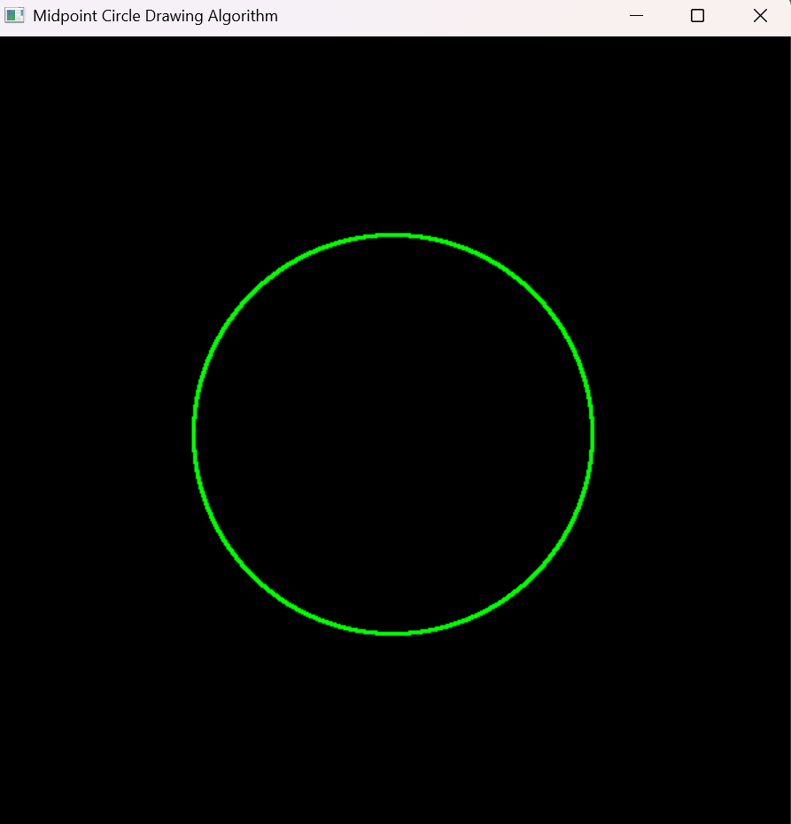

# Experiment 2: Midpoint Circle Drawing Algorithm

**File:** `exp2.py`

## Overview
This experiment implements the **Midpoint Circle Algorithm**, an efficient method for drawing circles using only integer arithmetic and symmetry.

## Formulas and Operations

### Midpoint Circle Algorithm
- **Initial decision parameter:** `p = 1 - r` where `r` is the circle radius
- **Starting point:** `(x, y) = (0, r)` at the top of the circle
- **Iteration loop** continues while `x < y`:
  - **Increment x:** `x += 1`
  - **Decision logic:**
    - If `p < 0`: `p += 2 * x + 1` (move east only)
    - If `p >= 0`: `y -= 1` and `p += 2 * (x - y) + 1` (move southeast)
- **Symmetry plotting:** For each calculated point `(x, y)`, all 8 symmetric points are plotted:
  - `(xc ± x, yc ± y)` and `(xc ± y, yc ± x)`

### Key Insight
The algorithm exploits the 8-way symmetry of circles, so only one octant needs to be calculated, and the rest are derived by symmetry.

## Visual Result


*The image shows a green circle centered at (300, 300) with radius 150, drawn using the midpoint circle algorithm.*

## How to Run

```bash
python exp2.py
```

### Requirements
- Python 3.x
- PyOpenGL
- PyGLUT
