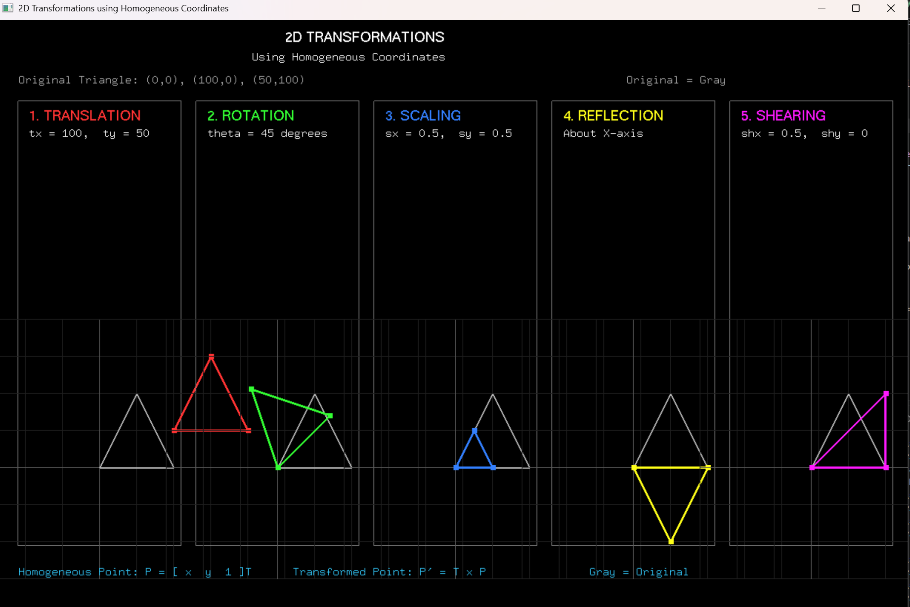

# Experiment 3: 2D Transformations Using Homogeneous Coordinates

**File:** `exp3.py`

## Overview
This experiment demonstrates **2D geometric transformations** using homogeneous coordinates. It applies multiple transformation matrices to a triangle and displays the original and transformed results.

## Formulas and Operations

### Homogeneous Coordinates
- Points represented as `[x, y, 1]` for transformation compatibility
- All transformations use 3×3 matrices operating on homogeneous coordinate vectors

### Transformation Matrices

**1. Translation**
```
T(tx, ty) = [[1, 0, tx],
             [0, 1, ty],
             [0, 0, 1]]
```
- Moves point by `tx` in x-direction and `ty` in y-direction

**2. Rotation**
```
R(angle) = [[cos(θ), -sin(θ), 0],
            [sin(θ),  cos(θ), 0],
            [0,       0,      1]]
```
- Rotates point by `angle` degrees counterclockwise
- Uses `θ = math.radians(angle)` to convert to radians

**3. Scaling**
```
S(sx, sy) = [[sx, 0, 0],
             [0,  sy, 0],
             [0,  0,  1]]
```
- Scales by `sx` in x-direction and `sy` in y-direction

**4. Reflection**
```
Reflection X: [[1, 0, 0],   [0, -1, 0],   [0, 0, 1]]
Reflection Y: [[-1, 0, 0],   [0,  1, 0],   [0, 0, 1]]
```

**5. Shearing**
```
Sh(shx, shy) = [[1, shx, 0],
                [shy, 1,  0],
                [0,   0,  1]]
```

### Triangle Transformation Pipeline
- Original triangle vertices: `(0, 0)`, `(100, 0)`, `(50, 100)`
- Each transformation is applied via `transform_triangle(matrix)` which multiplies the matrix by each point
- Original triangle displayed in gray, transformed triangles in various colors

## Visual Result


*The image displays the original triangle (gray) and its transformed versions under translation, rotation (45°), scaling (0.5x), reflection about X-axis, and shearing (0.5), each shown in separate panels with their respective parameter labels.*

## How to Run

```bash
python exp3.py
```

### Requirements
- Python 3.x
- PyOpenGL
- PyGLUT
