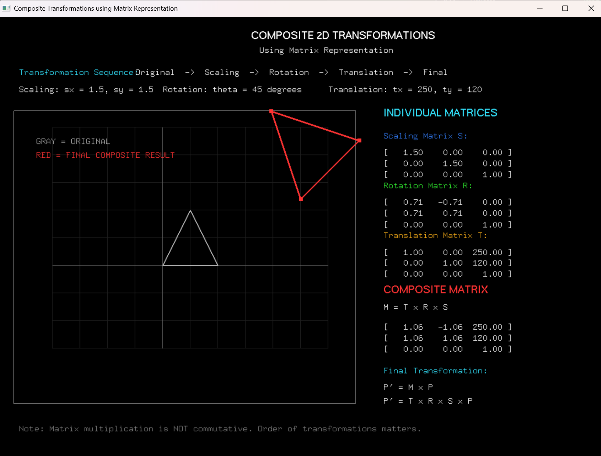

# Experiment 4: Composite 2D Transformations Using Matrix Representation

**File:** `exp4.py`

## Overview
This experiment demonstrates **composite 2D geometric transformations** using matrix representation with homogeneous coordinates. It applies a sequence of scaling, rotation, and translation transformations to a 2D object (triangle) and displays the intermediate and composite matrices alongside the visual result.

## Formulas and Operations

### Homogeneous Coordinates & Matrices
Points are represented in 2D homogeneous coordinates as `[x, y, 1]`.

#### 1. Scaling Matrix
```
S(sx, sy) = [[sx, 0,  0],
             [0,  sy, 0],
             [0,  0,  1]]
```
- Parameters: `sx = 1.5`, `sy = 1.5`

#### 2. Rotation Matrix
```
R(θ) = [[cos(θ), -sin(θ), 0],
        [sin(θ),  cos(θ), 0],
        [0,       0,      1]]
```
- Parameters: `θ = 45°` (`math.radians(45)`)

#### 3. Translation Matrix
```
T(tx, ty) = [[1, 0, tx],
             [0, 1, ty],
             [0, 0, 1]]
```
- Parameters: `tx = 250`, `ty = 120`

### Composite Transformation Matrix
- **Transformation Pipeline:** Original -> Scaling -> Rotation -> Translation -> Final
- **Composite Matrix Formula:** `M = T x R x S`
- **Point Transformation:** `P' = M x P`
- Matrix multiplication is non-commutative (`T x R x S != S x R x T`), meaning transformations are evaluated right-to-left.

## Visual Result


*The image displays the original triangle (gray), the composite transformed result (red), and the individual transformation matrices alongside the computed 3x3 composite matrix.*

## How to Run

```bash
python exp4.py
```

### Requirements
- Python 3.x
- PyOpenGL
- PyGLUT
