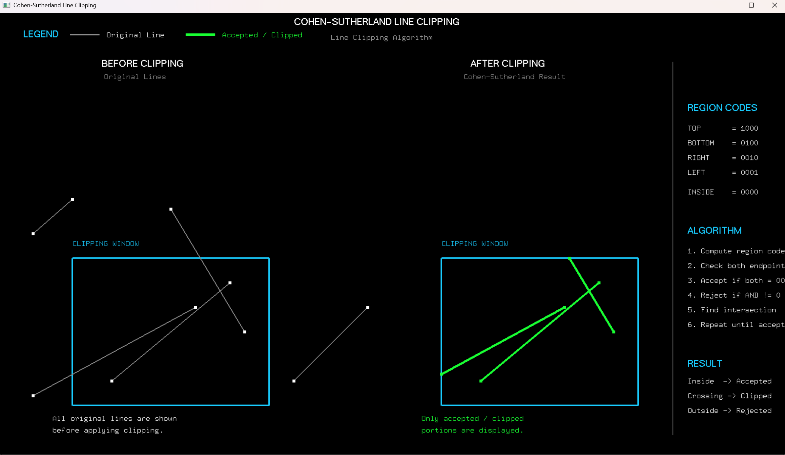

# Experiment 5: Cohen-Sutherland Line Clipping Algorithm

**File:** `exp5.py`

## Overview
This experiment implements the **Cohen-Sutherland Line Clipping Algorithm**, an efficient 2D clipping technique that uses 4-bit region codes (outcodes) to divide space and clip line segments against a rectangular viewing window.

## Formulas and Operations

### Region Codes (Outcodes)
The 2D space is divided into 9 regions defined by a 4-bit code `[TOP, BOTTOM, RIGHT, LEFT]`:
- **TOP** (`1000` = 8): `y > Y_MAX`
- **BOTTOM** (`0100` = 4): `y < Y_MIN`
- **RIGHT** (`0010` = 2): `x > X_MAX`
- **LEFT** (`0001` = 1): `x < X_MIN`
- **INSIDE** (`0000` = 0): `X_MIN <= x <= X_MAX` and `Y_MIN <= y <= Y_MAX`

### Clipping Algorithm Steps
1. **Compute Region Codes:** Calculate `code1` for `(x1, y1)` and `code2` for `(x2, y2)`.
2. **Trivial Accept:** If `code1 == 0` and `code2 == 0`, line is completely inside window.
3. **Trivial Reject:** If `(code1 & code2) != 0`, both endpoints share an outside region, line is completely outside.
4. **Intersection Calculation:** If neither trivial case holds, choose an endpoint with a non-zero code and clip against window boundary:
   - **Top Boundary (`y = Y_MAX`):** `x = x1 + (x2 - x1) * (Y_MAX - y1) / (y2 - y1)`
   - **Bottom Boundary (`y = Y_MIN`):** `x = x1 + (x2 - x1) * (Y_MIN - y1) / (y2 - y1)`
   - **Right Boundary (`x = X_MAX`):** `y = y1 + (y2 - y1) * (X_MAX - x1) / (x2 - x1)`
   - **Left Boundary (`x = X_MIN`):** `y = y1 + (y2 - y1) * (X_MIN - x1) / (x2 - x1)`
5. **Update Endpoint & Repeat:** Replace outside point with calculated intersection point and repeat until accepted or rejected.

### Clipping Window Dimensions
- `X_MIN = 100`, `X_MAX = 500`
- `Y_MIN = 100`, `Y_MAX = 400`

## Visual Result


*The image shows a side-by-side comparison: the left panel displays the original test lines inside/outside the blue clipping window, the middle panel shows only the accepted and clipped line segments in green, and the right panel details the 4-bit region codes and step-by-step clipping algorithm logic.*

## How to Run

```bash
python exp5.py
```

### Requirements
- Python 3.x
- PyOpenGL
- PyGLUT
