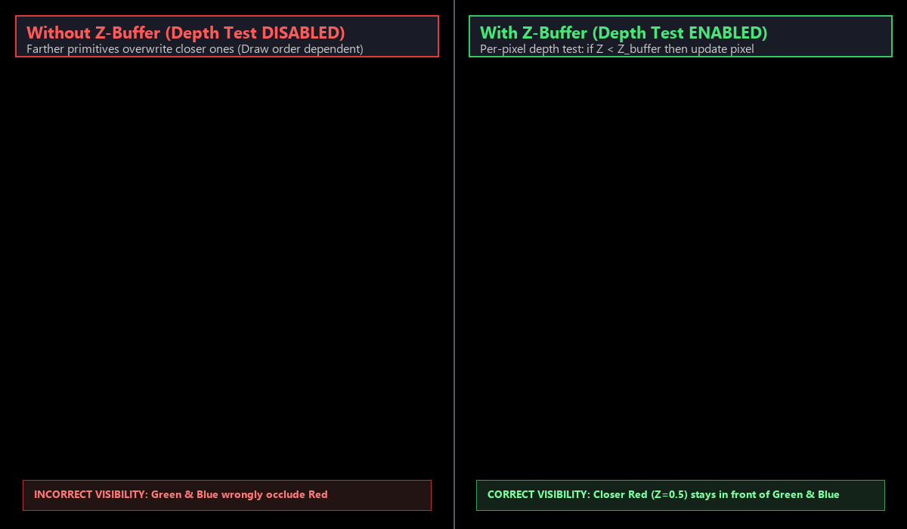

# Experiment 6: Z-Buffer Algorithm for Hidden Surface Removal

**File:** `exp6.py`

## Overview
This experiment implements the **Z-buffer (Depth-Buffer) Algorithm**, a fundamental image-space approach for hidden surface removal in 3D computer graphics. The algorithm determines which surface is visible at each pixel by maintaining per-pixel depth values and comparing incoming fragments against the stored minimum depth.

## Formulas and Operations

### Plane Equation and Depth Calculation
For any polygon surface defined in 3D space, its planar surface is represented by:
$$Ax + By + Cz + D = 0$$

Solving for depth $z$ at screen coordinate $(x, y)$:
$$z = \frac{-Ax - By - D}{C}$$

Along a scanline, as $x$ increments by $\Delta x = 1$:
$$z' = \frac{-A(x + 1) - By - D}{C} = z - \frac{A}{C}$$
This linear recurrence allows rapid per-pixel depth updates using only a single addition.

### Z-Buffer Data Structures
The algorithm utilizes two 2D buffers matching the screen dimensions ($W \times H$):
1. **Depth Buffer ($Z\text{-buffer}$):** Stores the normalized depth value of the closest surface visible so far for each pixel $(x, y)$.
2. **Color Buffer (Frame Buffer):** Stores the RGB color of the corresponding visible primitive.

### Buffer Initialization
At the start of each frame:
- $Z\text{-buffer}(x, y) = 1.0$ (representing the farthest depth / clipping plane)
- $\text{ColorBuffer}(x, y) = \text{Background Color}$

### Depth Comparison and Update Logic
During polygon rasterization, for each pixel $(x, y)$ covered by the polygon:
1. Compute the surface depth $z(x, y)$ at that pixel.
2. Compare the computed depth with the existing value in the depth buffer:
   $$\text{If } z(x, y) < Z\text{-buffer}(x, y):$$
   - $Z\text{-buffer}(x, y) \leftarrow z(x, y)$
   - $\text{ColorBuffer}(x, y) \leftarrow \text{Polygon Color}$
3. Otherwise, the incoming fragment is occluded and discarded.

### Comparative Demonstration
The implementation features a side-by-side viewport comparison:
- **Left Viewport (Depth Test Disabled):** Demonstrates the Painter's Algorithm failure. Primitives are drawn in back-to-front or arbitrary order, causing later-drawn objects (even if farther in 3D space) to overwrite closer objects.
- **Right Viewport (Depth Test Enabled):** Activates hardware Z-buffering with `GL_LESS`. The closer red triangle ($Z = 0.5$) consistently stays in front of the green ($Z = -0.2$) and blue ($Z = -0.6$) triangles, independent of drawing order.

## Visual Result


*The image displays a side-by-side comparison: the left viewport shows incorrect visibility when depth testing is disabled (later-drawn green and blue triangles incorrectly overwrite the red triangle), while the right viewport demonstrates correct hidden surface removal using the Z-buffer algorithm, preserving the closer red triangle in front.*

## How to Run

```bash
python exp6.py
```

To capture a screenshot and exit headlessly:
```bash
python exp6.py --headless
```

### Requirements
- Python 3.x
- PyOpenGL
- GLFW (`pip install glfw`)
- Pillow (`pip install pillow`)

