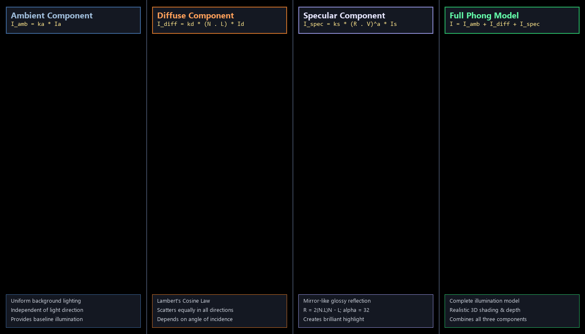

# Experiment 7: Phong Illumination Model for a 3D Object

**File:** `exp7.py`

## Overview
This experiment implements the **Phong Illumination Model**, a foundational local shading model in 3D computer graphics developed by Bui Tuong Phong. It computes realistic surface lighting by combining three distinct physical light-reflection phenomena: ambient reflection, diffuse (Lambertian) reflection, and specular reflection.

## Formulas and Operations

### Total Illumination Equation
The total reflected intensity $I$ at any surface point is the sum of ambient, diffuse, and specular components:
$$I = I_{\text{ambient}} + I_{\text{diffuse}} + I_{\text{specular}}$$

$$I = k_a I_a + k_d (\vec{N} \cdot \vec{L}) I_d + k_s (\vec{R} \cdot \vec{V})^\alpha I_s$$

### Vector Definitions
All vectors are normalized unit vectors:
- $\vec{N}$: Surface normal unit vector at the point of interest. For a unit sphere centered at origin, $\vec{N} = (x, y, z)$.
- $\vec{L}$: Light source direction unit vector directed from the surface point towards the light.
- $\vec{V}$: Viewer direction unit vector pointing towards the observer/camera.
- $\vec{R}$: Perfect mirror reflection direction vector.

### 1. Ambient Reflection ($I_{\text{ambient}}$)
Represents uniform, multi-directional background light resulting from repeated reflections from all environment surfaces:
$$I_{\text{ambient}} = k_a I_a$$
- $k_a$: Ambient reflection coefficient ($0 \le k_a \le 1$).
- $I_a$: Ambient light intensity.
- Independent of light source position and viewing angle; prevents completely dark unlit shadows.

### 2. Diffuse Reflection ($I_{\text{diffuse}}$)
Governed by **Lambert's Cosine Law**. Light hitting an ideal rough or matte surface is scattered uniformly in all hemispherical directions, with intensity proportional to the cosine of the angle of incidence $\theta$:
$$I_{\text{diffuse}} = k_d \max(0, \vec{N} \cdot \vec{L}) I_d$$
- $k_d$: Diffuse reflectivity coefficient ($0 \le k_d \le 1$).
- $I_d$: Incident point light source intensity.
- When $\vec{N} \cdot \vec{L} \le 0$, the surface faces away from the light source and receives zero diffuse light.

### 3. Specular Reflection ($I_{\text{specular}}$)
Models the glossy, mirror-like highlight observed on smooth surfaces. Light reflects primarily along the reflection vector $\vec{R}$ and drops off sharply as the viewer angle $\phi$ diverges from $\vec{R}$:
$$I_{\text{specular}} = k_s \max(0, \vec{R} \cdot \vec{V})^\alpha I_s$$
- $k_s$: Specular reflection coefficient ($0 \le k_s \le 1$).
- $I_s$: Specular light source intensity.
- $\alpha$: Surface shininess / roughness exponent (typically $1 \le \alpha \le 128$). Higher values produce tighter, sharper, and more brilliant highlights characteristic of polished surfaces.

### Reflected Vector Calculation
Using vector projection, the mirror reflection vector $\vec{R}$ is calculated as:
$$\vec{R} = 2(\vec{N} \cdot \vec{L})\vec{N} - \vec{L}$$

## Visual Result


*The image displays a comprehensive four-panel decomposition of the Phong illumination model applied to a 3D sphere: Panel 1 shows the uniform Ambient component ($I_{amb}$), Panel 2 displays the Lambertian Diffuse shading ($I_{diff}$), Panel 3 isolates the glossy Specular highlight ($I_{spec}$), and Panel 4 combines all three into the complete photorealistic Phong illumination model.*

## How to Run

```bash
python exp7.py
```

To capture a screenshot and exit headlessly:
```bash
python exp7.py --headless
```

### Controls (Interactive Mode)
- The light source rotates automatically around the 3D sphere to demonstrate dynamic real-time specular highlights and diffuse shading.
- Press `Esc` or close window to exit.

### Requirements
- Python 3.x
- PyOpenGL
- GLFW (`pip install glfw`)
- Pillow (`pip install pillow`)

