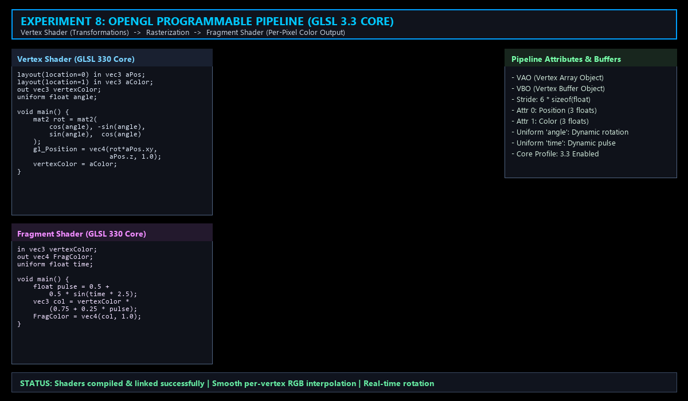

# Experiment 8: OpenGL Vertex and Fragment Shaders

**File:** `exp8.py`

## Overview
This experiment demonstrates the **modern programmable graphics pipeline** in OpenGL using GLSL (OpenGL Shading Language) version 3.3 Core Profile. In modern OpenGL, fixed-function pipelines are replaced with programmable shader stages that execute directly on GPU cores: a **Vertex Shader** that computes vertex coordinates and geometric transformations, and a **Fragment Shader** that determines the final pixel colors with smooth barycentric color interpolation.

## Formulas and Operations

### Programmable Graphics Pipeline Architecture
```
[Vertex Data] -> [VBO / VAO] -> [Vertex Shader] -> [Primitive Assembly & Rasterization] -> [Fragment Shader] -> [Framebuffer]
```

### 1. Vertex Shader (GLSL 330 Core)
The vertex shader executes once for each vertex specified in the input buffer. It transforms vertex positions into clip space coordinates and forwards interpolated attributes:

#### Transformation Matrix
A dynamic 2D rotation matrix is constructed inside the vertex shader using the uniform variable `angle` ($\theta$):
$$R(\theta) = \begin{bmatrix} \cos\theta & -\sin\theta \\ \sin\theta & \cos\theta \end{bmatrix}$$

$$\begin{bmatrix} x' \\ y' \end{bmatrix} = \begin{bmatrix} \cos\theta & -\sin\theta \\ \sin\theta & \cos\theta \end{bmatrix} \begin{bmatrix} x \\ y \end{bmatrix}$$

$$\text{gl\_Position} = \begin{bmatrix} x' \\ y' \\ z \\ 1.0 \end{bmatrix}$$

The input attribute `aColor` is assigned directly to `out vec3 vertexColor`, preparing it for rasterization interpolation.

### 2. Rasterization & Color Interpolation
During hardware rasterization, the GPU rasterizer clips triangles against the viewing frustum and computes fragments. Vertex attributes (such as color) are smoothly interpolated across the triangle surface using **barycentric coordinates** $(\lambda_1, \lambda_2, \lambda_3)$:
$$C(x, y) = \lambda_1 C_1 + \lambda_2 C_2 + \lambda_3 C_3 \quad \text{where } \lambda_1 + \lambda_2 + \lambda_3 = 1$$

### 3. Fragment Shader (GLSL 330 Core)
The fragment shader runs per-pixel/fragment to evaluate the final color. It takes the interpolated `vertexColor` and modulates intensity dynamically using a sine-wave time pulse:
$$\text{pulse}(t) = 0.5 + 0.5 \sin(2.5 \cdot t)$$
$$\text{Color}(t) = \text{vertexColor} \times (0.75 + 0.25 \cdot \text{pulse}(t))$$
$$\text{FragColor} = \text{vec4}(\text{Color}(t), 1.0)$$

### 4. GPU Buffer Architecture
- **Vertex Buffer Object (VBO):** High-speed GPU video memory buffer containing interleaved vertex positions `[X, Y, Z]` and RGB colors `[R, G, B]`.
- **Vertex Array Object (VAO):** Encapsulates all vertex attribute configurations and buffer bindings:
  - Attribute Index `0`: Position `(3 * sizeof(float))` with offset 0.
  - Attribute Index `1`: Color `(3 * sizeof(float))` with offset `3 * sizeof(float)`.
  - Total Stride: `6 * sizeof(float)`.

## Visual Result


*The image shows the modern OpenGL 3.3 programmable pipeline in action: an animated, smoothly color-interpolated RGB triangle rendered using custom GLSL vertex and fragment shaders with per-vertex color attributes, GPU buffer management (VAO/VBO), and dynamic rotation uniforms.*

## How to Run

```bash
python exp8.py
```

To capture a screenshot and exit headlessly:
```bash
python exp8.py --headless
```

### Controls (Interactive Mode)
- Real-time continuous rotation and dynamic color pulsation via GPU uniform variables.
- Press `Esc` or close window to exit.

### Requirements
- Python 3.x
- PyOpenGL
- GLFW (`pip install glfw`)
- NumPy (`pip install numpy`)
- Pillow (`pip install pillow`)
- OpenGL 3.3 Core Profile compatible GPU

