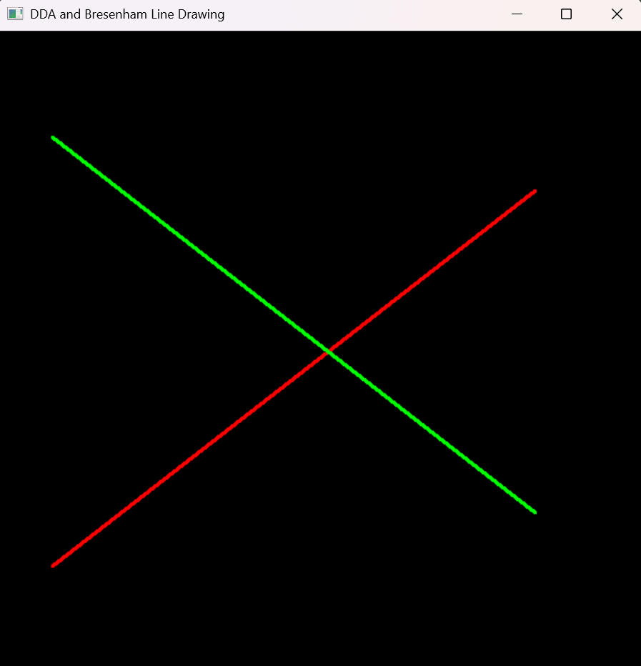
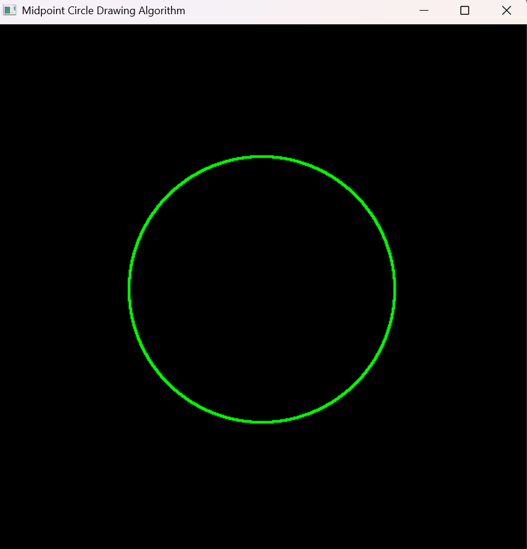
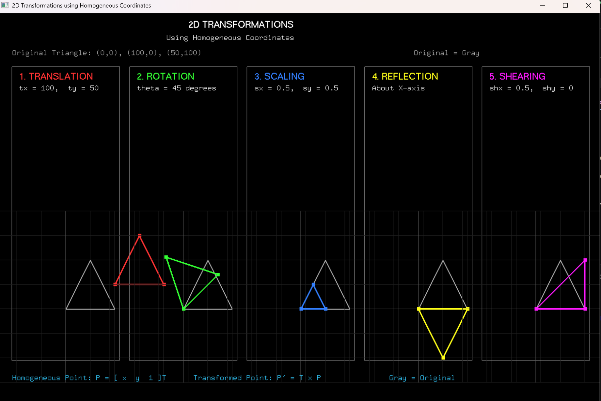
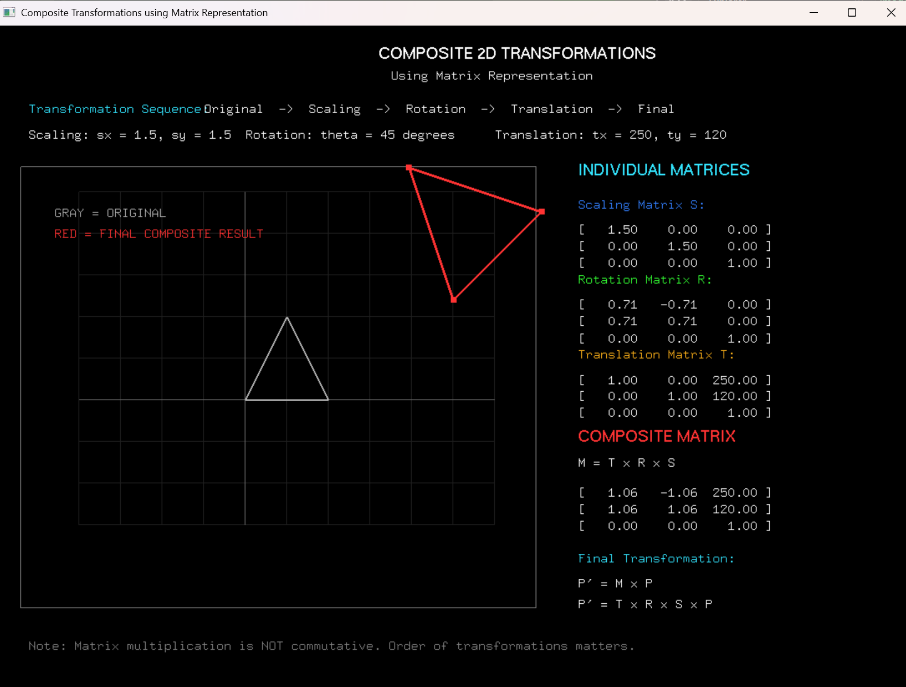
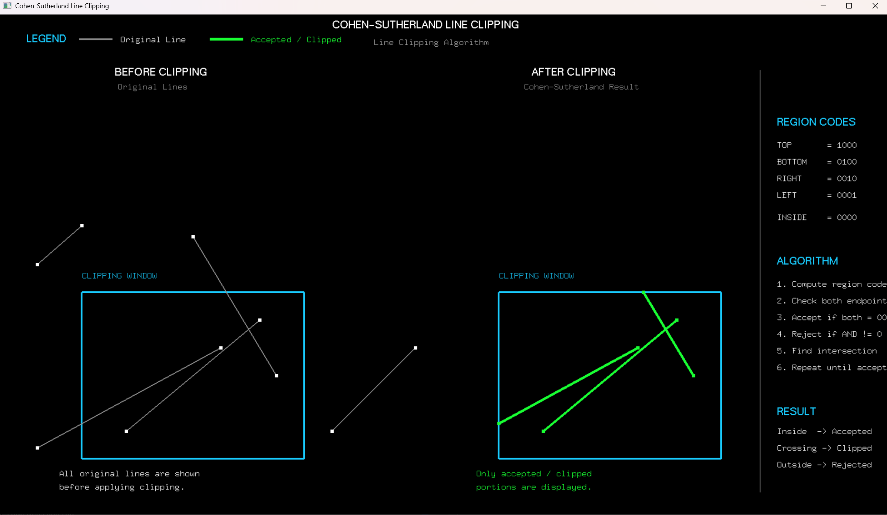

# Experiments

This folder contains five computer graphics experiments implemented in Python using OpenGL. Each experiment demonstrates a fundamental graphics algorithm and produces a visual result.

---

## Experiment 1: DDA and Bresenham Line Drawing Algorithms

**File:** `Experiment_1/exp1.py`

### Overview
This experiment implements two classic line drawing algorithms:
- **DDA (Digital Differential Analgorithm)** - A simple line drawing algorithm that uses floating-point arithmetic
- **Bresenham's Line Algorithm** - An efficient line drawing algorithm using integer arithmetic

### Formulas and Operations

#### DDA Algorithm
- **Step calculation:** `steps = max(abs(dx), abs(dy))` where `dx = x2 - x1` and `dy = y2 - y1`
- **Increment values:** 
  - `x_inc = dx / steps`
  - `y_inc = dy / steps`
- **Line generation:** Iterates from 0 to `steps`, plotting points at each step by incrementing x and y by their respective increments
- **Pixel plotting:** `plot(x, y)` rounds coordinates to nearest integer: `int(round(x)), int(round(y))`

#### Bresenham Algorithm
- **Error term initialization:** `err = dx - dy` where `dx = abs(x2 - x1)` and `dy = abs(y2 - y1)`
- **Decision parameters:**
  - If `e2 > -dy`: adjust error by `-dy` and increment x by `sx`
  - If `e2 < dx`: adjust error by `dx` and increment y by `sy`
- **Step direction:** `sx = 1 if x1 < x2 else -1`, `sy = 1 if y1 < y2 else -1`
- **Plot points** at `(x1, y1)` iteratively until reaching `(x2, y2)`

### Visual Result


*The image shows a red line drawn using DDA algorithm and a green line drawn using Bresenham algorithm between the points (50, 100) to (500, 450) and (50, 500) to (500, 150) respectively.*

---

## Experiment 2: Midpoint Circle Drawing Algorithm

**File:** `Experiment_2/exp2.py`

### Overview
This experiment implements the **Midpoint Circle Algorithm**, an efficient method for drawing circles using only integer arithmetic and symmetry.

### Formulas and Operations

#### Midpoint Circle Algorithm
- **Initial decision parameter:** `p = 1 - r` where `r` is the circle radius
- **Starting point:** `(x, y) = (0, r)` at the top of the circle
- **Iteration loop** continues while `x < y`:
  - **Increment x:** `x += 1`
  - **Decision logic:**
    - If `p < 0`: `p += 2 * x + 1` (move east only)
    - If `p >= 0`: `y -= 1` and `p += 2 * (x - y) + 1` (move southeast)
- **Symmetry plotting:** For each calculated point `(x, y)`, all 8 symmetric points are plotted:
  - `(xc ± x, yc ± y)` and `(xc ± y, yc ± x)`

#### Key Insight
The algorithm exploits the 8-way symmetry of circles, so only one octant needs to be calculated, and the rest are derived by symmetry.

### Visual Result


*The image shows a green circle centered at (300, 300) with radius 150, drawn using the midpoint circle algorithm.*

---

## Experiment 3: 2D Transformations Using Homogeneous Coordinates

**File:** `Experiment_3/exp3.py`

### Overview
This experiment demonstrates **2D geometric transformations** using homogeneous coordinates. It applies multiple transformation matrices to a triangle and displays the original and transformed results.

### Formulas and Operations

#### Homogeneous Coordinates
- Points represented as `[x, y, 1]` for transformation compatibility
- All transformations use 3×3 matrices operating on homogeneous coordinate vectors

#### Transformation Matrices

**1. Translation**
```
T(tx, ty) = [[1, 0, tx],
             [0, 1, ty],
             [0, 0, 1]]
```
- Moves point by `tx` in x-direction and `ty` in y-direction

**2. Rotation**
```
R(angle) = [[cos(θ), -sin(θ), 0],
            [sin(θ),  cos(θ), 0],
            [0,       0,      1]]
```
- Rotates point by `angle` degrees counterclockwise
- Uses `θ = math.radians(angle)` to convert to radians

**3. Scaling**
```
S(sx, sy) = [[sx, 0, 0],
             [0,  sy, 0],
             [0,  0,  1]]
```
- Scales by `sx` in x-direction and `sy` in y-direction

**4. Reflection**
```
Reflection X: [[1, 0, 0],   [0, -1, 0],   [0, 0, 1]]
Reflection Y: [[-1, 0, 0],   [0,  1, 0],   [0, 0, 1]]
```

**5. Shearing**
```
Sh(shx, shy) = [[1, shx, 0],
                [shy, 1,  0],
                [0,   0,  1]]
```

#### Triangle Transformation Pipeline
- Original triangle vertices: `(0, 0)`, `(100, 0)`, `(50, 100)`
- Each transformation is applied via `transform_triangle(matrix)` which multiplies the matrix by each point
- Original triangle displayed in gray, transformed triangles in various colors

### Visual Result


*The image displays the original triangle (gray) and its transformed versions under translation, rotation (45°), scaling (0.5x), reflection about X-axis, and shearing (0.5), each shown in separate panels with their respective parameter labels.*

---

## Experiment 4: Composite 2D Transformations Using Matrix Representation

**File:** `Experiment_4/exp4.py`

### Overview
This experiment demonstrates **composite 2D geometric transformations** using matrix representation with homogeneous coordinates. It applies a sequence of scaling, rotation, and translation transformations to a 2D triangle and displays the individual and composite matrices alongside the visual output.

### Formulas and Operations

#### Homogeneous Coordinates & 3x3 Matrices
- **Scaling Matrix S:** `sx = 1.5, sy = 1.5`
- **Rotation Matrix R:** `θ = 45°` (`math.radians(45)`)
- **Translation Matrix T:** `tx = 250, ty = 120`

#### Composite Matrix Formula
- **Pipeline:** `Original -> Scaling -> Rotation -> Translation -> Final`
- **Composite Matrix:** `M = T x R x S`
- **Transformed Point:** `P' = M x P`
- **Non-Commutativity:** Note that matrix multiplication is non-commutative (`T x R x S != S x R x T`), so the transformations are evaluated right-to-left.

### Visual Result


*The image displays the original triangle (gray), the composite transformed result (red), and the individual transformation matrices alongside the computed 3x3 composite matrix.*

---

## Experiment 5: Cohen-Sutherland Line Clipping Algorithm

**File:** `Experiment_5/exp5.py`

### Overview
This experiment implements the **Cohen-Sutherland Line Clipping Algorithm**, an efficient 2D line clipping technique that uses 4-bit region codes (outcodes) to clip line segments against a rectangular viewing window.

### Formulas and Operations

#### Region Codes (Outcodes)
The 2D space is divided into 9 regions defined by 4-bit region codes `[TOP, BOTTOM, RIGHT, LEFT]`:
- **TOP** (`1000` = 8): `y > Y_MAX`
- **BOTTOM** (`0100` = 4): `y < Y_MIN`
- **RIGHT** (`0010` = 2): `x > X_MAX`
- **LEFT** (`0001` = 1): `x < X_MIN`
- **INSIDE** (`0000` = 0)

#### Decision & Clipping Logic
- **Trivial Accept:** `code1 == 0` and `code2 == 0`
- **Trivial Reject:** `(code1 & code2) != 0`
- **Intersection Formulas:**
  - **Top (`y = Y_MAX`):** `x = x1 + (x2 - x1) * (Y_MAX - y1) / (y2 - y1)`
  - **Bottom (`y = Y_MIN`):** `x = x1 + (x2 - x1) * (Y_MIN - y1) / (y2 - y1)`
  - **Right (`x = X_MAX`):** `y = y1 + (y2 - y1) * (X_MAX - x1) / (x2 - x1)`
  - **Left (`x = X_MIN`):** `y = y1 + (y2 - y1) * (X_MIN - x1) / (x2 - x1)`

#### Window Coordinates
- `X_MIN = 100`, `X_MAX = 500`, `Y_MIN = 100`, `Y_MAX = 400`

### Visual Result


*The image shows a side-by-side comparison: the left panel displays the original test lines inside/outside the blue clipping window, the middle panel shows only the accepted and clipped line segments in green, and the right panel details the 4-bit region codes and step-by-step clipping algorithm logic.*

---

## How to Run

Each experiment can be run independently using Python with OpenGL support:

```bash
# Experiment 1
python Experiment_1/exp1.py

# Experiment 2
python Experiment_2/exp2.py

# Experiment 3
python Experiment_3/exp3.py

# Experiment 4
python Experiment_4/exp4.py

# Experiment 5
python Experiment_5/exp5.py
```

**Requirements:**
- Python 3.x
- PyOpenGL
- PyGLUT

## License

These experiments are for educational purposes, demonstrating fundamental computer graphics algorithms.